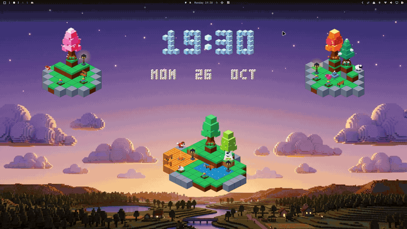

<div align="center">



# 🌲 Voxel
### Interactive 3D Isometric Voxel Sandbox & Living World Builder for Linux

[](https://buymeacoffee.com/rover01)
[](https://kernel.org)
[](https://hyprland.org)
[](https://quickshell.outfoxxed.me)
[](LICENSE)

<br/>

### 🏝️ Modular Island Builder • 🐾 Living Wildlife AI • 🌸 Drifting Blossom Particles • ⏱️ Floating 3D Clock • ⚙️ Performance Settings

<br/>

**Voxel** is a desktop diorama plugin engineered for **[Omarchy](https://github.com/omarchy)** and **[Quickshell](https://quickshell.outfoxxed.me)** on Linux (Wayland / Hyprland). Build floating sky islands, peaceful alpine villages, serene sakura gardens, and living miniature worlds right across your wallpaper.

[Features](#-key-features) • [Catalog](#-element-catalog) • [Controls](#-controls--shortcuts) • [Installation](#-installation) • [Support](#-support--donations)

</div>

---

## 🌟 Overview

Unlike heavy 3D game engines, **Voxel** renders lightweight isometric 3D voxel graphics using pure accelerated **QML / QtQuick Canvas**. Every block, creature, tree, and scenic prop lives natively on your Wayland desktop layer, maintaining smooth animations and responsive desktop performance.

Whether you want a tranquil Japanese zen garden with drifting cherry blossom petals, a crackling autumn campfire surrounded by sleeping foxes, or an expansive floating archipelago, Voxel gives you a modular sandbox directly on your screen.

---

## ✨ Key Features

- 🧱 **Magnetic Isometric Snap-Grid**:
  - Blocks and structures magnetically connect along genuine 2:1 isometric axes ($dx = \pm 28\text{px}, dy = \pm 14\text{px}$).
  - Multi-tier vertical stacking along the elevation axis with automatic 3D isometric depth sorting (`naturalZ`).
  - Zero interpenetration or texture bleeding between adjacent faces.

- 🌸 **Living Animated Voxel Trees**:
  - **Sakura**: Floating cherry blossom canopies with wind sway and drifting pink petal particles.
  - **Autumn Maple**: Warm golden-amber foliage with animated leaf flurries.
  - **White Birch**: Shimmering pale leaves with natural pollen and sunlight reflections.
  - **Alpine Pine**: Geometric evergreen needles sculpted for mountain crags.
  - **Majestic Oak**: Broad leafy canopy overlooking the landscape.
  - 100% continuous harmonic animation cycles — zero pop-in, jarring resets, or loop seams.

- 🐾 **Autonomous Wandering Wildlife**:
  - **Chicken**: Waypoint surface pathfinding, alternating leg walking cycles, head-bobbing, and grass pecking.
  - **Fox**: Cozy sleeping postures, ambient breathing, and flicking tail.
  - **Cat**: Calico feline surveying the landscape with gentle tail swaying.
  - **Sheep**: Fluffy cloud-wool sheep grazing on meadow shorelines.
  - **Pig**: Playful pink pig with animated ear twitches and snout motion.
  - Real-time obstacle avoidance locked strictly to walkable surface blocks.

- 🏮 **Scenic Interactive Props**:
  - **Campfire**: Stone-ring firepit with dancing flame voxels and rising smoke embers.
  - **Fountain**: Cobblestone multi-tier fountain with water waves and splash droplets.
  - **Arched Timber Bridge**: Wooden footbridge designed to cross water lagoons and ravines.
  - **River Stepping Stones**: River rock pavers with mossy stone detailing.
  - **Streetlamp & Lantern**: Vintage lamp posts with breathing warm amber illumination.
  - **Park Bench**: Polished wood slats with wrought-iron frame.
  - **Rustic Fence**: Post-and-rail wooden boundary segments.
  - **Wildflower Gardens**: Blooming poppies, tulips, and orchids with gentle breeze sway.

- 🧲 **Cluster Physics & Selection**:
  - Multi-block selection bounding outline to move entire floating islands together at once.
  - Synchronized cluster elevation shifting and 360° structure rotation.
  - Intelligent spawn placement: new items spawn into a clean staging zone without colliding with existing islands.

- ⚙️ **Animation Performance Profiles**:
  - Dedicated **Settings** tab in the panel with three instant profiles:
    - **High**: Full visual fidelity — GPU tree sways, atmospheric weather particles, flickering flames, water splashes, and active wildlife AI.
    - **Low**: Lightweight & power-efficient — preserves animated wildlife and essential movement while idling heavy ambient particle emitters.
    - **Off**: Absolute minimal footprint — freezes background repaints to minimize idle CPU usage.

---

## 📦 Element Catalog

| Category | Elements Available | Visual Properties |
| :--- | :--- | :--- |
| **Modular Blocks** | Grass, Stone, Wood, Brick, Gold, Crystal, Obsidian, Lava, Water, Planks | 100% isometric alignment, directional shading, water wave caustics |
| **Living Trees** | Sakura, Oak, Autumn Maple, Pine, Birch | Continuous particle emitters (petals, leaves, pollen) |
| **Wildlife** | Chicken, Fox, Cat, Sheep, Pig | Autonomous wandering, resting AI, surface level lock |
| **Scenic Props** | Campfire, Fountain, Bridge, Stepping Stones, Streetlamp, Bench, Fence, Flowers | Ambient lighting, water splash droplets, flame embers |

---

## 🎮 Controls & Shortcuts

| Action | Control / Interaction | Description |
| :--- | :--- | :--- |
| **Select / Inspect** | `Left Click` | Focuses the block or prop and displays quick-action handles |
| **Single Move** | `Click + Drag` | Moves the block with real-time magnetic snapping to nearby blocks |
| **Cluster Move** | `Drag Outer Border` | Moves all connected blocks in the floating island simultaneously |
| **Layer Elevation** | `▲` / `▼` Buttons | Elevates the block or structure up/down across 3D isometric tiers |
| **Rotate Prop** | `↻` / `↺` Buttons | Rotates props and structures in 90° isometric steps |
| **Remove** | `✕` Button | Deletes individual items or bulk removes selected clusters |

---

## 🚀 Installation

### Prerequisites
- **Linux** (Wayland session, e.g. Hyprland)
- **[Quickshell](https://quickshell.outfoxxed.me)** & **[Omarchy](https://github.com/omarchy)**

### Quickstart
1. Clone the repository into your projects directory:
   ```bash
   git clone https://github.com/rover-001/voxel.git ~/Projects/voxel
   ```

2. Symlink the plugin into your Omarchy plugins folder:
   ```bash
   ln -s ~/Projects/voxel ~/.config/omarchy/plugins/voxel
   ```

3. Reload Omarchy:
   ```bash
   omarchy restart shell
   ```

4. Click the **Voxel** icon in your top bar or open the picker panel to start placing modular blocks and scenic dioramas!

### Removal
To remove the plugin:
```bash
rm ~/.config/omarchy/plugins/voxel
omarchy restart shell
```

---

## 💖 Support & Donations

If you enjoy building worlds with **Voxel** on your desktop, consider supporting the development! Every coffee helps keep this project free, open-source, and constantly improving with new blocks, creatures, and biome features.

<div align="center">

[](https://buymeacoffee.com/rover01)

👉 **[https://buymeacoffee.com/rover01](https://buymeacoffee.com/rover01)**

*Thank you for your support and feedback!*

</div>

---

## 📄 License

This project is licensed under the **MIT License** — see the [LICENSE](LICENSE) file for full details.
